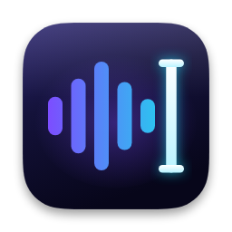

<p align="center">
  
</p>

<h1 align="center">My Flow</h1>

<p align="center">
  Hold a key, speak, and cleaned-up text appears in whatever app you are using.<br>
  A native, open-source voice-dictation app for macOS 26 (Tahoe).
</p>

<p align="center">
  
  
  
</p>

My Flow is an open-source take on [Wispr Flow](https://wisprflow.ai). It lives in your menu bar. You hold the **Fn** key, talk, let go, and a moment later your words are typed into the text field you were in, with the "um"s removed and the punctuation fixed. It is written in Swift and SwiftUI, with a small floating "Flow Bar" that uses macOS 26's Liquid Glass look.

This README is written for people who may never have built an app before. If you can copy and paste into Terminal, you can install it.

> My Flow is not affiliated with, endorsed by, or connected to Wispr Flow.

---

## Table of contents

1. [What it does](#what-it-does)
2. [How it works](#how-it-works)
3. [Requirements](#requirements)
4. [API keys](#api-keys)
5. [Installation](#installation)
6. [Code signing (read this if permissions keep resetting)](#code-signing)
7. [Adding your API keys](#adding-your-api-keys)
8. [Permissions walkthrough](#permissions-walkthrough)
9. [Using My Flow](#using-my-flow)
10. [Configuration reference](#configuration-reference)
11. [Privacy](#privacy)
12. [Troubleshooting](#troubleshooting)
13. [Uninstalling completely](#uninstalling-completely)
14. [Project structure](#project-structure)
15. [Development](#development)
16. [Acknowledgements](#acknowledgements)
17. [License](#license)

---

## What it does

- **Push-to-talk dictation anywhere.** Hold `Fn`, speak, release. The cleaned text is pasted at your cursor in any app.
- **Hands-free mode.** Press `Fn` together with `Cmd` to start recording without holding anything; press `Fn` again to stop.
- **Loud mode.** `Shift` + `Fn` starts a hands-free recording that skips the on-device model and asks the cleanup step to correct words garbled by background noise.
- **AI command mode.** `Fn` + `Space`: speak an instruction ("reply to this email saying I'll be there at 3", "make this shorter") and the AI writes the result at your cursor. It can see your currently selected text and, if you allow it, a screenshot of your screen.
- **Transforms.** Select text anywhere, press `Option` + a number (1 to 9), and a saved instruction (for example "Polish") rewrites the selection in place.
- **Speech-to-text with several engines.** On-device NVIDIA Parakeet for short clips, Cohere Transcribe in the cloud, Groq Whisper as a speed hedge, and OpenRouter Whisper as a last resort.
- **LLM cleanup.** Removes filler words, false starts and repeats; fixes punctuation and capitalization; keeps your wording. Very short, simple dictations are cleaned on-device with no network round trip.
- **Dictionary.** Names and jargon you want spelled a particular way. My Flow can also suggest words to add when you correct its spelling.
- **Snippets.** Say a trigger phrase ("my email") and a saved expansion is inserted literally.
- **Styles.** Choose how cleanup writes: Default, Professional, Casual, or your own.
- **History.** Every dictation is saved with its original and cleaned text, the app it went into, and its audio. Copy, re-paste, search, or retry failed ones.
- **Never lose a dictation.** If transcription fails, the audio is kept and you can retry later. If you cancel a recording by accident, you can usually recover it.
- **Scratchpad** for quick notes, and **Insights** with words this week, time saved, your streak, and a words-per-day chart.
- **Menu-bar app** with a microphone picker, "Copy Last Dictation", and quick access to the main window and Settings.
- **Optional client vault** (advanced): a folder of per-client notes that My Flow reads when you mention a client by name in AI command mode.

---

## How it works

When you release the key, the audio (16 kHz mono WAV) goes through this pipeline:

```text
  hold Fn  ──►  microphone  ──►  release Fn
                                    │
                                    ▼
                 ┌─────────────────────────────────────┐
                 │ Short clip (15 s or less) and not   │
                 │ loud mode and local model ready?    │
                 └───────────────┬─────────────────────┘
                       yes       │        no / unusable result
              ┌──────────────────┘            │
              ▼                               ▼
   On-device Parakeet TDT 0.6B v3     Cohere Transcribe (cloud), starts at once
   (about 0.15 s, offline)                    │
              │                               │  if Cohere is slow (2.5 s for clips
              │                               │  up to 30 s, longer for longer clips)
              │                               │  or fails, a second engine joins the race:
              │                               │    Groq whisper-large-v3-turbo (if a Groq
              │                               │    key is set), else on-device Parakeet
              │                               │  First usable answer wins.
              │                               ▼
              │                      still nothing usable?
              │                      OpenRouter Whisper (last resort, one retry)
              │                               │
              └──────────────┬────────────────┘
                             ▼
                    raw transcript
                             │
              ┌──────────────┴───────────────┐
              ▼                              ▼
   dictation / loud mode              AI command mode (Fn+Space)
              │                              │
   12 words or fewer and simple?      LLM on OpenRouter, given your
   ├─ yes: on-device cleanup          instruction + selected text
   │       (no network)               + screenshot (if allowed)
   └─ no:  LLM cleanup on OpenRouter  + matching client notes
           Llama 3.3 70B, raced
           against Gemini Flash-Lite
              │                              │
              ▼                              ▼
       apply snippets                  final text
              │                              │
              └──────────────┬───────────────┘
                             ▼
              paste at cursor (Cmd+V) and leave the
              result on the clipboard; save to History
```

The details, as implemented in `Services.swift`, `Engine.swift` and `LocalCleanup.swift`:

**Speech-to-text routing**

1. **Local first for short clips.** If the clip is 15 seconds or shorter, you did not use loud mode, and the Parakeet model has finished loading, the clip is transcribed on your Mac. The result is used unless it is empty, looks like a repetition loop, or (for clips under 3 seconds) is just a filler such as "okay", "yeah" or "thank you" (a typical false result on near-silence). In those cases the clip goes to the cloud.
2. **Cohere Transcribe** (`cohere-transcribe-03-2026`) is the main cloud engine. It starts immediately.
3. **Hedged race.** If Cohere has not answered after 2.5 seconds (clips up to 30 s; slightly longer for longer clips), or if it fails or returns a repetition loop, a second engine starts and the first usable answer wins. The second engine is Groq (`whisper-large-v3-turbo`) when a Groq key is set; otherwise the on-device model, if it is loaded. If Groq fails, the on-device model is tried.
4. **Silence is final.** If Cohere cleanly returns nothing, My Flow reports "Heard nothing" rather than asking another engine (which tends to hallucinate "Thank you.").
5. **Last resort.** OpenRouter Whisper (default model `openai/whisper-large-v3`, changeable in Settings), with one retry after 2 seconds.
6. **If everything fails,** the audio is already saved. The Flow Bar tells you, and you can retry from History.

Loud mode and **Retry** never use the on-device model: loud mode because the cloud model handles noise better, and Retry because the on-device model would simply produce the same output again.

**Cleanup routing**

- Dictations of 12 words or fewer that are plain (no digits, quotes, brackets, multiple sentences, dictation-command words such as "comma" or "new line", or anything resembling a self-correction like "wait" or "actually") are cleaned on-device: fillers removed, immediate repeats collapsed, capitalization and a final period added. No wording is rewritten. Anything that looks like a question without a question mark, or sounds close to a word in your Dictionary, is sent to the LLM instead.
- Everything else goes to the LLM on OpenRouter. The primary model is `meta-llama/llama-3.3-70b-instruct`, routed to the fastest hosts. If it has not replied after 0.9 seconds, `google/gemini-3.1-flash-lite` is asked too and whichever answers first is used.
- Snippets are applied after cleanup, literally. The LLM never sees your snippet text.

---

## Requirements

| What | Details |
| --- | --- |
| **macOS** | macOS 26 (Tahoe) or later. This is enforced in `Package.swift` and the app's `Info.plist`. |
| **Mac** | An Apple Silicon Mac (M1 or newer) is recommended and is what the project is built and tested on. The on-device Parakeet model runs through Apple's CoreML and Neural Engine via FluidAudio, which targets Apple Silicon. I have not tested on Intel Macs, and macOS 26 itself is not supported on all of them. |
| **Toolchain** | A Swift 6 toolchain. `Package.swift` declares `swift-tools-version: 6.0`. Installing **Xcode 26** from the App Store is the easiest route. The Command Line Tools alone (`xcode-select --install`) may be enough for `swift build`, but Xcode is the safe choice. |
| **Disk space** | About 500 MB for the on-device speech model (the Parakeet model folder is roughly 460 MB on disk), plus space for build files and saved audio. |
| **Internet** | Needed once to download the Parakeet model, and for cloud transcription and cleanup afterwards. |
| **Microphone** | Any input device macOS can see. |

**Check your Swift version** in Terminal:

```bash
swift --version
```

You should see "Swift version 6.x". If the command is not found, install Xcode (or run `xcode-select --install`). If Xcode is installed but Terminal complains about a license, run `sudo xcodebuild -license accept`.

**Where the Parakeet model comes from.** On every launch My Flow calls `LocalASR.warmUp()`. The first time, this downloads the model (`parakeet-tdt-0.6b-v3`, multilingual) from Hugging Face into `~/Library/Application Support/FluidAudio/Models/` and compiles it for your chip, which can take a minute or two. After that it loads from disk in the background. Until it finishes loading, everything goes to the cloud engines. Settings → Models shows "Ready" once it is loaded.

---

## API keys

My Flow talks to three cloud services. You bring your own keys; nothing is bundled.

| Service | Variable name | Powers | Required? |
| --- | --- | --- | --- |
| [Cohere](https://dashboard.cohere.com/api-keys) | `COHERE_API_KEY` | Main cloud speech-to-text (Cohere Transcribe). | Strongly recommended |
| [OpenRouter](https://openrouter.ai/keys) | `OPENROUTER_API_KEY` | Text cleanup, AI command mode, Transforms, and the last-resort Whisper fallback. | Strongly recommended |
| [Groq](https://console.groq.com/keys) | `GROQ_API_KEY` | Fast Whisper "hedge" when Cohere is slow. | Optional |

**How to get each key**

- **Cohere:** sign up at <https://dashboard.cohere.com>, then open "API keys" and create one. Trial keys are free but rate-limited and can be slower.
- **OpenRouter:** sign up at <https://openrouter.ai>, add some credit, then create a key at <https://openrouter.ai/keys>.
- **Groq:** sign up at <https://console.groq.com>, then create a key at <https://console.groq.com/keys>.

**Cost.** All three are pay-as-you-go (some have free tiers or trial allowances). Pricing changes, so check each provider's pricing page. In the code, a typical cleanup call is a fraction of a cent.

**What works with no keys at all**

With zero keys, My Flow still installs and runs, but only partly:

- Short clips (15 seconds or less) are transcribed on your Mac by Parakeet, once the model has downloaded. No account needed.
- Short, simple dictations (12 words or fewer) are cleaned on-device and pasted.
- Longer clips can still be transcribed on-device (it is used as the fallback when Cohere fails), but the result needs LLM cleanup.
- **Cleanup that needs the LLM fails without an OpenRouter key.** The dictation is then marked as failed in History with its audio saved, and you can retry once you add a key. Likewise, AI command mode and Transforms need an OpenRouter key.

In short: no keys gives you short offline dictation. Add an OpenRouter key for full cleanup and AI features, and a Cohere key for best accuracy on longer or noisy recordings.

---

## Installation

### 1. Get the code

```bash
git clone https://github.com/ai-harry/MyFlow.git
cd MyFlow
```

### 2. (Recommended) Create a signing certificate

Do this first if you plan to rebuild more than once. See [Code signing](#code-signing). You can skip it for a first try.

### 3. Build and install

```bash
./build.sh
```

If you see "permission denied", run `chmod +x build.sh` and try again.

`build.sh` does the following:

1. Runs `swift build -c release`. The first build downloads the FluidAudio package and compiles it, so it can take several minutes.
2. Deletes any old `/Applications/My Flow.app` and creates a fresh app bundle there.
3. Writes an `Info.plist` (bundle ID `com.harry.myflow` unless you override it, minimum macOS 26.0, microphone usage text).
4. Copies in the compiled program and the app icon (`Resources/AppIcon.icns`).
5. Code-signs the app (with your certificate if found, otherwise ad-hoc; see below).
6. Registers the app with macOS Launch Services.

When it finishes it prints `Installed /Applications/My Flow.app`.

### 4. First launch

1. Open **My Flow** from Applications (or Spotlight). The first time, macOS may ask you to confirm opening it.
2. A waveform icon appears in the menu bar and a small Flow Bar appears on screen. The main window opens too.
3. macOS shows the **Accessibility** prompt. Follow the [permissions walkthrough](#permissions-walkthrough). Hotkeys start working as soon as you enable it, with no restart needed.
4. Add your [API keys](#adding-your-api-keys).
5. In another app, click into a text field, hold `Fn`, say a sentence, and let go. The macOS **Microphone** prompt appears the first time you record; allow it.

---

## Code signing

macOS ties permissions (Microphone, Accessibility, Screen Recording) to an app's *code signature*. `build.sh` signs with an identity named **`MyFlow Dev Signing`** by default.

- **If that identity exists in your keychain,** every rebuild is signed the same way and macOS keeps your permissions.
- **If it does not,** `build.sh` prints `Signing identity "MyFlow Dev Signing" not found; using ad-hoc signing.` An ad-hoc signature changes on every build, so macOS may treat each rebuild as a brand-new app and **ask for Microphone and Accessibility again**, or silently stop honoring the old grant.

You do not need a paid Apple Developer account. A free self-signed certificate is enough.

### Create a self-signed code-signing certificate

1. Open **Keychain Access** (Spotlight: "Keychain Access").
2. In the menu bar choose **Keychain Access → Certificate Assistant → Create a Certificate…**
3. Fill in:
   - **Name:** `MyFlow Dev Signing`
   - **Identity Type:** Self-Signed Root
   - **Certificate Type:** Code Signing
4. Click **Create**, then **Continue** and **Done**.
5. Verify from Terminal:

   ```bash
   security find-identity -v -p codesigning
   ```

   You should see a line containing `"MyFlow Dev Signing"`. If the list shows "0 valid identities found", the certificate was not created as a Code Signing certificate; repeat the steps above.
6. Run `./build.sh` again. It should no longer print the ad-hoc warning.

If macOS asks to allow `codesign` to use the key, choose **Always Allow**.

### Using different names

`build.sh` reads two optional environment variables:

| Variable | Default | Meaning |
| --- | --- | --- |
| `MYFLOW_SIGN_IDENTITY` | `MyFlow Dev Signing` | Name of the code-signing identity to use. |
| `MYFLOW_BUNDLE_ID` | `com.harry.myflow` | Bundle identifier written into the app. |

Example:

```bash
MYFLOW_SIGN_IDENTITY="My Own Cert" MYFLOW_BUNDLE_ID="com.example.myflow" ./build.sh
```

Changing the bundle ID makes macOS treat it as a different app, so permissions and saved preferences (stored under that ID) start fresh. Your history, dictionary and keys are not affected because they live in `~/Library/Application Support/MyFlow/`.

---

## Adding your API keys

You can do this in two ways. Both end up in the same file: `~/Library/Application Support/MyFlow/.env`.

### Option A: in the app

Open **Settings** (`Cmd` + `,`, or menu-bar icon → Settings…) → **Models** → **API keys**. Paste a key and press Save (or Return). The row shows "Saved" with the last four characters hidden behind dots. "Remove" deletes the key. The app writes the file with permissions limited to your user.

### Option B: create the file yourself

In Terminal:

```bash
mkdir -p "$HOME/Library/Application Support/MyFlow"
nano "$HOME/Library/Application Support/MyFlow/.env"
```

Paste lines in exactly this format (replace the placeholders with your own keys):

```bash
COHERE_API_KEY=your-cohere-key-here
OPENROUTER_API_KEY=your-openrouter-key-here
GROQ_API_KEY=your-groq-key-here
```

Save (`Ctrl+O`, Return, `Ctrl+X`), then restrict the file so only you can read it:

```bash
chmod 600 "$HOME/Library/Application Support/MyFlow/.env"
```

Format rules, from the parser in `Settings.swift`:

- One `NAME=value` per line. Blank lines and lines starting with `#` are ignored.
- An optional leading `export ` is accepted.
- Values may optionally be wrapped in matching single or double quotes.
- The recognized names are `COHERE_API_KEY`, `OPENROUTER_API_KEY`, `GROQ_API_KEY`. Anything else is ignored, with one exception: `OPENROUTER_MODEL` sets the model used for AI command mode, but only if you have not already chosen one in Settings.
- The file is read when the app starts. If you edit it by hand while My Flow is running, quit and reopen the app. Keys saved through Settings take effect immediately.

Never commit this file to Git or share it. It is outside the project folder on purpose.

---

## Permissions walkthrough

My Flow asks macOS for up to three permissions. All are under **System Settings → Privacy & Security**.

| Permission | Needed for | Required? |
| --- | --- | --- |
| **Microphone** | Recording your voice. | Yes |
| **Accessibility** | Listening for the `Fn` key and other hotkeys globally (an event tap), pasting text with a simulated `Cmd+V`, copying your selection with `Cmd+C` for AI mode and Transforms, and the dictionary-suggestion feature that reads the focused text field. | Yes |
| **Screen Recording** | Letting AI command mode (`Fn` + `Space`) look at your screen. | Optional |

### Granting them

1. **Accessibility.** On first launch macOS shows a prompt. Click **Open System Settings**, find **My Flow** under *Privacy & Security → Accessibility*, and switch it on. If it is not in the list, click **+**, choose `/Applications/My Flow.app`, and switch it on. My Flow checks again every 2 seconds, so hotkeys go live right away.
2. **Microphone.** macOS asks the first time you record. If you clicked Don't Allow, go to *Privacy & Security → Microphone* and enable My Flow. The Flow Bar will show "Microphone access denied" until you do.
3. **Screen Recording (optional).** Open **Settings → Advanced → Grant Screen Recording (for AI screen context)**, then enable My Flow under *Privacy & Security → Screen Recording*. macOS may ask you to quit and reopen the app. Without this permission AI mode still works, just without the screenshot.

### Resetting permissions

If a permission is stuck (for example after rebuilding with an ad-hoc signature), remove the old entry and ask again:

1. In System Settings, select **My Flow** in the relevant list and click **−** to remove it.
2. Quit My Flow (menu-bar icon → Quit My Flow).
3. Optionally reset macOS's record of the permission from Terminal:

   ```bash
   tccutil reset Accessibility com.harry.myflow
   tccutil reset Microphone com.harry.myflow
   tccutil reset ScreenCapture com.harry.myflow
   ```

   Replace `com.harry.myflow` with your bundle ID if you changed it. To reset every permission for the app, use `tccutil reset All com.harry.myflow`.
4. Reopen My Flow and grant the permission again.

Setting up a stable [signing certificate](#code-signing) prevents most of this.

---

## Using My Flow

### Hotkeys

| Keys | What happens |
| --- | --- |
| Hold `Fn` | **Push-to-talk.** Recording runs while you hold it. Release to transcribe and paste. Holding for less than 0.3 seconds is treated as an accidental tap and cancelled silently. |
| `Fn` + `Cmd` | **Hands-free.** Either press `Fn` while already holding `Cmd`, or hold `Fn` and then press `Cmd`. Recording is "latched" so you can let go. Press `Fn` again to stop and process. |
| `Shift` + `Fn` | **Loud mode.** Starts hands-free immediately. Skips the on-device model and tells the cleanup step to aggressively fix noise-induced mistakes. Press `Fn` again to stop. |
| `Fn` + `Space` | **AI command mode.** The Space key is swallowed (no space is typed). You can press it while holding `Fn` for push-to-talk or when idle. Speak an instruction; press `Fn` again to stop and run it. The AI's output is pasted at the cursor, replacing your selection if you had text selected. |
| `Esc` | **Cancel** the current recording. Recordings longer than about one second are saved to History as "cancelled" rather than discarded. |
| `Option` + `Z` | **Recover** the recording you just cancelled with `Esc` (works for the most recent cancel; the Flow Bar reminds you for 8 seconds). |
| `Option` + `1` to `9` | **Run a Transform** on the currently selected text, if a transform exists in that slot and transform hotkeys are enabled. |
| `Option` + `Y` / `Option` + `N` | Accept / dismiss a dictionary suggestion, only while the "Add word to dictionary?" capsule is showing. |
| `Cmd` + `,` | Open Settings (when My Flow is the active app). |

Two things to know about `Fn`:

- On many Macs the `Fn`/Globe key also triggers an emoji picker, dictation or input-source switching. Go to **System Settings → Keyboard** and set **"Press 🌐 key to"** to **Do Nothing**, otherwise macOS may react to the same key. (The Shortcuts tab in Settings reminds you of this.)
- Because the app listens for key events globally, it needs the Accessibility permission above.

You can start a new recording while an earlier one is still being transcribed; the earlier one finishes in the background.

### The Flow Bar

A small pill at the bottom of the screen (toggle it in Settings → General). It follows your system light/dark appearance unless you force one.

| State | What you see |
| --- | --- |
| Idle | A short thin line. |
| Connecting mic | "Connecting mic…" for a moment (Bluetooth headsets take about a second to switch into microphone mode). |
| Recording (push-to-talk) | Live audio waveform. |
| Hands-free | Waveform with a hand icon and "Hands-free". |
| Loud mode | Waveform with a speaker icon and "Loud". |
| AI mode | Waveform with a sparkles icon and "AI". |
| Processing | Spinner with "Transcribing…", "Cleaning up…", "Thinking…", "Retrying…" or a transform's name. |
| Done | Green check with a preview of the text that was pasted. |
| Error | Red triangle with a message, such as "Heard nothing", "No text selected", or "Transcription failed — audio saved. Retry from the My Flow app." |
| Suggestion | "Add "word" to dictionary?" with Add / dismiss buttons. Press `Option`+`Y` or `Option`+`N`. |

Sounds play at key moments (start, stop, success, error) and can be turned off. While you record, other audio on your Mac is muted and restored afterwards (also optional).

### Menu-bar menu

Click the waveform icon in the menu bar:

- A status line ("Ready — hold fn to dictate", "Recording…", "Transcribing…", or the error).
- A preview of your last successful dictation and **Copy Last Dictation**.
- **Microphone** submenu to pick your input device (this sets the macOS default input).
- **Open My Flow** (main window).
- **Settings…**
- **Quit My Flow**.

Closing the main window does not quit the app: hotkeys, the Flow Bar and the menu-bar icon stay active. To quit, use the menu-bar icon → Quit My Flow. By default there is no Dock icon while only the menu bar is showing; the Dock icon appears while a window is open, or always if you turn on "Always show in Dock".

After a dictation, the result is also left on your clipboard, so you can paste it again elsewhere.

### The main window

Open it from the menu bar (Open My Flow) or by clicking the app icon. The sidebar has:

**Library**

- **History.** Every dictation, newest first, with search. Select one to see the cleaned text, switch to "Show Original" for the raw transcript, and see the app, date and time, duration, word count, mode (dictation, loud, AI) and status. Buttons: **Copy**, **Re-paste** (hides My Flow and pastes into the app behind it), **Retry** (for failed or cancelled entries that still have saved audio) and **Delete** (also deletes the saved audio).
- **Scratchpad.** Simple notes with a title and body. Handy for dictating into without another app open.

**Customise**

- **Dictionary.** Words and names to spell your way. They are passed to the cleanup and AI-command prompts as preferred spellings. Example: add `Kubernetes` or `Priya Venkataraman`. Click **Add Word**. Short dictations that contain a word close to a dictionary entry skip the on-device shortcut so the LLM can apply your spelling.
- **Snippets.** A trigger phrase and an expansion. Example: trigger `my email`, expansion `name@example.com`. Say "send it to my email" and the expansion is substituted into the text. Matching is case-insensitive and tolerates the comma or period that cleanup may add after the phrase.
- **Style.** Instructions that shape how cleanup writes. Three come built in: *Default* ("Natural written English. Keep the speaker's tone."), *Professional* and *Casual*. Add your own, for example "Short sentences, no exclamation marks". Pick the active style here or in Settings → Dictation.
- **Transforms.** Saved instructions bound to `Option` + a number (slot 1 to 9). Two come built in: slot 1 **Polish** ("Improve clarity and conciseness without changing meaning") and slot 2 **Prompt Engineer** ("Rewrite this as a well-structured prompt for an AI model"). Add your own, for example slot 3 "Translate to Spanish". To use one: select text in any app and press `Option` + the slot number. My Flow copies your selection, sends it to the AI with your instruction, and pastes the result over it. If nothing is selected it shows "No text selected". Your previous clipboard contents are restored after the selection is copied.

**Insights**

- Words this week, time saved, your day streak, and a words-per-day chart.

### Retrying failed dictations

If transcription or cleanup fails (no network, bad key, service outage), the Flow Bar says the audio was saved. Open **My Flow → History**, select the entry (status shows as failed), and click **Retry**. On success the result is copied to your clipboard (it is not pasted, because your focus has moved on) and the history entry is updated. Retry always uses the cloud engines. The newest 100 recordings are kept on disk; older audio is deleted automatically, though the text stays in History.

### Dictionary suggestions

About ten seconds after a paste, My Flow quietly looks at the text field you pasted into. If you fixed the spelling of a single word, the Flow Bar offers to add the corrected word to your Dictionary: `Option`+`Y` to accept, `Option`+`N` to dismiss, or ignore it and it fades after 8 seconds. This uses the Accessibility permission and does nothing if the field cannot be read.

### AI command mode examples

With `Fn` + `Space`, speak an instruction and keep holding `Fn` or press `Fn` again to finish:

- Select a paragraph, then say "make this friendlier". The paragraph is replaced.
- With nothing selected, say "write a two-line out-of-office reply". The text appears at your cursor.
- With Screen Recording allowed, open an email and say "draft a reply that says yes". The AI sees a downscaled screenshot of your main display as context.
- If you set up a [client vault](#optional-client-vault) and mention a client by name or alias, that client's notes are added as background.

### Optional client vault

An advanced feature for people who keep per-client notes (for example in Obsidian). In **Settings → Dictation → Client vault**, choose a folder. My Flow creates a `Clients/` folder and a short README inside it. Use **New Client** to create `Clients/<Name>/` with `client.md` (profile and aliases), `meetings/`, `chats/` and `log.md`. When you mention a client's name, alias, or company in AI command mode, My Flow includes that client's profile, recent log, and newest meeting and chat notes in the AI prompt. Fill in the `aliases` line of `client.md` with the names you actually say out loud. This only affects AI command mode, not ordinary dictation.

---

## Configuration reference

Open Settings with `Cmd` + `,` or from the menu bar. Preferences are saved automatically.

### General

| Setting | What it does | Default |
| --- | --- | --- |
| Launch at login | Starts My Flow when you log in (main window stays closed). | Off |
| Always show in Dock | Keeps a Dock icon even when no window is open. | Off |
| Show Flow Bar | Shows or hides the floating bar. | On |
| Flow Bar appearance | Follow system, Dark, or Light. | Follow system |
| Dictation sounds | Plays short system sounds for start, stop, success and error. | On |
| Mute other audio while recording | Mutes your Mac's output while the mic is live, then restores it. | On |

### Dictation

| Setting | What it does | Default |
| --- | --- | --- |
| Microphone | Choose the input device (changes the macOS default input). | System default |
| Language | Language hint sent to the transcription engines. Options: English, Spanish, French, German, Italian, Portuguese, Dutch, Polish, Arabic, Chinese, Japanese, Korean, Vietnamese, Greek. | English |
| Style | Active cleanup style (see Style in the main window). | Default |
| Client vault | Optional folder of client notes for AI command mode. | Not set |

### Models

| Setting | What it does | Default |
| --- | --- | --- |
| API keys | Cohere, OpenRouter and Groq keys, stored in the `.env` file. | Not set |
| Cleanup model | OpenRouter model for cleanup and Transforms. | `meta-llama/llama-3.3-70b-instruct` |
| Backup cleanup model | The model raced against the primary after 0.9 s. Read-only. | `google/gemini-3.1-flash-lite` |
| AI command model | OpenRouter model for `Fn` + `Space`. Can be seeded with `OPENROUTER_MODEL` in `.env`. | `moonshotai/kimi-k3` |
| ASR fallback model | OpenRouter Whisper model used as the last resort. | `openai/whisper-large-v3` |
| Local Parakeet | Shows "Ready" once the on-device model is loaded. | Loads at launch |

### Shortcuts

| Setting | What it does | Default |
| --- | --- | --- |
| Hotkey list | A reference card for the built-in shortcuts. The keys themselves are not remappable in this version. | n/a |
| Enable Option-number transform hotkeys | Turns `Option` + 1 to 9 on or off. | On |

### Advanced

| Setting | What it does |
| --- | --- |
| Open Data Folder | Opens `~/Library/Application Support/MyFlow/` in Finder. |
| Open Debug Log | Opens `debug.log`. |
| Grant Screen Recording | Triggers the macOS permission prompt for AI screen context. |

---

## Privacy

My Flow has no account, no analytics and no server of its own. It makes network requests only to the services you configure.

**What leaves your Mac**

| Data | Goes to | When |
| --- | --- | --- |
| Your recorded audio | **Cohere** (`api.cohere.com`) | Whenever a clip is not handled by the on-device model, which is any clip longer than 15 seconds, loud mode, retries, and short clips where the local result looked unusable. |
| Your recorded audio | **Groq** (`api.groq.com`) | Only if you set a Groq key and Cohere is slow or fails. |
| Your recorded audio | **OpenRouter** | Only if the other engines fail (last-resort Whisper). |
| The transcript text, plus your style and Dictionary words | **OpenRouter** | Whenever LLM cleanup runs, meaning everything except short simple dictations that are cleaned on-device. Requests may be served by third-party model hosts chosen by OpenRouter. |
| Your spoken instruction, selected text, Dictionary words, optional screenshot, and matched client notes | **OpenRouter** | In AI command mode, and for Transforms (selected text plus the transform instruction). |

Your **snippet** triggers and expansions are never sent to an AI model; they are substituted on your Mac.

Each provider has its own privacy policy and retention rules. Read them if this matters for your use case.

**What stays on your Mac**

- On-device transcription (Parakeet) never sends audio anywhere. Short, simple dictations can be fully offline.
- Your API keys, history, dictionary, snippets, styles, transforms and notes.
- The screenshot is taken only in AI command mode, only if you granted Screen Recording, and is held in memory and sent with that one request. It is not saved to disk.

**Where data is stored**

Everything lives in `~/Library/Application Support/MyFlow/`:

| Path | Contents |
| --- | --- |
| `myflow.db` | SQLite database: History, Dictionary, Snippets, Styles, Transforms, Scratchpad notes. |
| `pending/*.wav` | Saved audio of your most recent 100 recordings (kept so you can retry). |
| `.env` | Your API keys (permissions `600`). |
| `debug.log` | Diagnostic log. It records timings, engine choices and errors, but not your transcripts. |

The Parakeet model is stored separately in `~/Library/Application Support/FluidAudio/Models/`. App preferences are stored by macOS under your bundle ID (`com.harry.myflow` by default).

**Deleting your data.** Delete individual history items in the app (this also removes their audio), or remove everything by following [Uninstalling completely](#uninstalling-completely).

---

## Troubleshooting

**Holding Fn does nothing.**
1. Check *System Settings → Privacy & Security → Accessibility*: My Flow must be listed and switched on. If it is on but still dead, switch it off and on, or remove it with **−** and reopen My Flow.
2. Check *System Settings → Keyboard* and set **"Press 🌐 key to"** to **Do Nothing**.
3. On an external keyboard with no `Fn` key, this version cannot be triggered. The shortcuts are not configurable.
4. Open `debug.log` and look for `tap installed OK` or `tapCreate FAILED`. `FAILED` means the Accessibility permission is missing. My Flow also rebuilds its key listener after sleep and if macOS disables it.
5. Make sure only one copy of My Flow is running. A second copy exits on its own.

**"Microphone access denied" or "Microphone captured no audio".**
- Enable My Flow under *Privacy & Security → Microphone*.
- Choose the right device from the menu-bar Microphone submenu. Check the input volume and any hardware mute switch.
- Bluetooth headsets can take about a second to switch to microphone mode; the bar says "Connecting mic…". If the mic still delivers nothing after 4 seconds, My Flow aborts with an error.

**"Heard nothing".**
The engines returned no speech, or the clip was under 1.5 seconds and looked like a silence hallucination ("thank you", "okay"). Speak a little longer, closer to the mic, or try Loud mode in noisy rooms.

**Transcription is slow.**
- Short clips (15 s or less) should feel instant once Settings → Models shows Local Parakeet as Ready. If it says "Not loaded", the model may still be downloading or compiling; give it a few minutes with an internet connection.
- Longer clips depend on your upload speed to Cohere. A trial Cohere key can also be slow. Adding a Groq key lets a second engine join the race when Cohere lags.
- Without a working OpenRouter key, anything needing LLM cleanup fails.
- Check `debug.log` for lines such as `pipeline: audio ... | asr ... | cleanup ...` to see where the time went.

**"Transcription failed — audio saved".**
Check your internet connection and API keys (Settings → Models), then open History and click Retry. The error text from the provider (for example `Cohere 401`) is in `debug.log`; 401 usually means a wrong or expired key.

**The text did not paste, or pasted in the wrong place.**
My Flow pastes with `Cmd`+`V` into whichever app is frontmost, so click into the target text field first. The result is always on your clipboard, so you can paste it manually. Some secure fields refuse synthetic paste.

**Permissions reset after every rebuild.**
You are using an ad-hoc signature. Create the [self-signed certificate](#code-signing) and rebuild, then grant permissions once more.

**I don't see any window.**
Closing the window keeps the app running in the menu bar. Click the waveform icon in the menu bar and choose **Open My Flow**. If you do not see the menu-bar icon, the menu bar may be crowded; try quitting other menu-bar apps or check that the app is running in Activity Monitor.

**The Flow Bar is missing.**
Turn on Settings → General → Show Flow Bar.

**Build errors.**
- `error: package requires minimum macOS version 26.0` or similar: you need macOS 26 and Xcode 26.
- Swift version too old: run `swift --version`; you need Swift 6. Update Xcode and then run `sudo xcode-select -s /Applications/Xcode.app`.
- Xcode license errors: run `sudo xcodebuild -license accept`.
- Package download failures: check your connection and rerun. To start clean, run `rm -rf .build` and then `./build.sh`.
- "Signing identity not found" is only a warning; the build continues with ad-hoc signing.

**Viewing the debug log.**
Use Settings → Advanced → Open Debug Log, or in Terminal:

```bash
tail -f "$HOME/Library/Application Support/MyFlow/debug.log"
```

---

## Uninstalling completely

Quit My Flow first (menu-bar icon → Quit My Flow), then:

```bash
# The app
rm -rf "/Applications/My Flow.app"

# Your data: history, dictionary, audio, API keys, logs
rm -rf "$HOME/Library/Application Support/MyFlow"

# The downloaded on-device speech model (about 460 MB)
rm -rf "$HOME/Library/Application Support/FluidAudio"

# Saved preferences (use your bundle ID if you changed it)
defaults delete com.harry.myflow
```

If you turned on "Launch at login", turn it off first in Settings → General, or remove My Flow from *System Settings → General → Login Items*. You can also remove My Flow from the Accessibility, Microphone and Screen Recording lists, or run `tccutil reset All com.harry.myflow`. Remove the `MyFlow Dev Signing` certificate in Keychain Access if you created one. Note that `FluidAudio/Models` may be shared with other apps that use FluidAudio, so skip that step if you also use such apps.

---

## Project structure

```text
myflow-native/
├── Package.swift          Swift package definition (macOS 26, FluidAudio 0.17.7)
├── Package.resolved       Pinned dependency versions
├── build.sh               Build, bundle, sign and install into /Applications
├── Resources/
│   └── AppIcon.icns       App icon used by build.sh
├── docs/
│   └── icon.png           Icon shown in this README
└── Sources/MyFlow/        All of the app's source code
```

| File (`Sources/MyFlow/`) | Role |
| --- | --- |
| `App.swift` | App entry point, window and Dock handling, single-instance guard, Accessibility prompt/retry, sleep/wake recovery. |
| `Hotkeys.swift` | Global key listener (event tap) and the hotkey state machine; also the `mflog` debug logger. |
| `Engine.swift` | The brain: recording phases, pipeline orchestration (record, transcribe, clean up, paste), cancel/recover/retry, Transforms, dictionary suggestions. |
| `Services.swift` | Cloud calls: Cohere and OpenRouter transcription, the hedged ASR race, OpenRouter chat, cleanup and AI prompts, snippet expansion. |
| `LocalASR.swift` | On-device Parakeet TDT speech recognition via FluidAudio. |
| `GroqASR.swift` | Groq Whisper client used as the speed hedge. |
| `LocalCleanup.swift` | On-device fast-path cleanup for short, simple dictations. |
| `Audio.swift` | Microphone capture to 16 kHz mono audio, with a pre-armed engine and error handling. |
| `AudioDevices.swift` | Lists and selects input devices. |
| `AudioDucking.swift` | Mutes output while recording and restores it afterwards. |
| `Paste.swift` | Clipboard and synthetic keystrokes (paste, copy selection), plus the system sounds. |
| `Screenshot.swift` | Optional screen capture for AI command mode. |
| `FieldReader.swift` | Reads the focused text field to detect spelling corrections for dictionary suggestions. |
| `ClientContext.swift` | Matches spoken client names against the vault and builds context for the AI prompt. |
| `VaultManager.swift` | Creates the client vault folder structure and templates. |
| `Store.swift` | SQLite storage for history, dictionary, snippets, styles, transforms and notes. |
| `Settings.swift` | App preferences and `.env` API-key loading/saving. |
| `SettingsWindow.swift` | The Settings window (General, Dictation, Models, Shortcuts, Advanced). |
| `MainWindow.swift` | Main window shell and sidebar. |
| `HistoryView.swift` | History list, search and actions. |
| `HistoryDetail.swift` | History detail pane (cleaned/original text, metadata, retry). |
| `Views2.swift` | Dictionary, Snippets, Style, Transforms and Scratchpad pages. |
| `InsightsView.swift` | Insights page (stats and chart). |
| `FlowBar.swift` | The floating Liquid Glass Flow Bar. |
| `MenuBar.swift` | Menu-bar icon and menu. |
| `DesignSystem.swift` | Shared spacing and styling helpers. |

---

## Development

**Requirements:** the same as above (macOS 26, Swift 6 toolchain).

```bash
# Debug build (fast to compile, not installed anywhere)
swift build

# Release build only (what build.sh runs first)
swift build -c release

# Full build + install into /Applications + sign
./build.sh
```

Notes:

- The Swift package targets macOS 26 and uses the Swift 5 language mode for the app target (`.swiftLanguageMode(.v5)`) with a Swift 6 toolchain. FluidAudio is pinned to version 0.17.7.
- There is no automated test suite in this repository yet.
- Running the bare `.build/debug/MyFlow` binary will not behave like the installed app (no bundle ID or Info.plist, so the microphone permission prompt may not work). Use `./build.sh` for testing real behavior.
- **Logs:** `~/Library/Application Support/MyFlow/debug.log`. It shows key events, which ASR engine won and how long each stage took. Some startup messages go to the system log; view them in Console.app by searching for "MyFlow" or run `log stream --process MyFlow`.
- **Data folder:** `~/Library/Application Support/MyFlow/`. Delete `myflow.db` to reset all app data (a new one with the default styles and transforms is created on next launch).
- Rebuilding replaces `/Applications/My Flow.app`; quit the running copy first.

**Contributing.** Issues and pull requests are welcome. Please keep changes focused, build with `./build.sh` before submitting, describe how you tested the change (which hotkeys, which engines), and never include API keys, logs containing private text, or audio in an issue or PR.

---

## Acknowledgements

- [FluidAudio](https://github.com/FluidInference/FluidAudio) by FluidInference, for running speech models on Apple's Neural Engine from Swift.
- [NVIDIA Parakeet TDT 0.6B v3](https://huggingface.co/nvidia/parakeet-tdt-0.6b-v3), the on-device speech recognition model.
- [Cohere](https://cohere.com) for Cohere Transcribe.
- [Groq](https://groq.com) for fast Whisper inference.
- [OpenRouter](https://openrouter.ai) for access to Llama, Gemini, Whisper and other models through one API.
- Inspired by [Wispr Flow](https://wisprflow.ai). My Flow is an independent project and is not affiliated with Wispr Flow.

---

## License

No license has been chosen yet — all rights reserved by the author until one is added.
